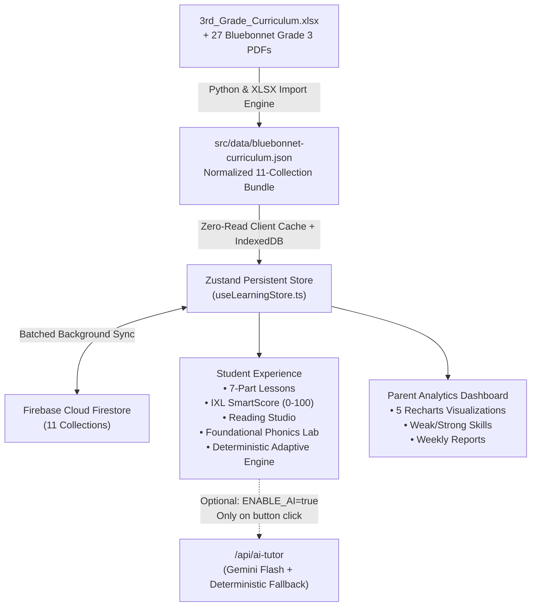

# 🌸 Bluebonnet Quest — Grade 3 Texas TEKS Learning Platform

A production-ready, gamified **Grade 3 Learning Platform** built on the official **Texas Bluebonnet Learning Curriculum** (Mathematics Modules 1–7, Reading Language Arts Units 1–10, and Foundational Skills Units 1–10). Designed to behave like **IXL**, **Khan Academy Kids**, **DreamBox**, and **Prodigy** while operating **100% within the Firebase Free Tier (Spark Plan)**.

---

## 🏗️ 1. System Architecture & Free Tier Design



### Why This Runs 100% on the Firebase Free Tier (Spark Plan)
1. **Zero AI Required for Student Learning (`NEXT_PUBLIC_ENABLE_AI=false` by default)**:
   - All 27 Bluebonnet Units, 27 7-part lessons, worked examples, hints, reading passages, vocabulary, phonics activities, and 54+ questions are pre-structured and stored in the curriculum database.
   - The **Adaptive Learning Engine** is 100% deterministic (rule-based): when `SmartScore < 60`, it automatically recommends `easierSkillId`, displays the worked example, and schedules a retest.
   - **Text-To-Speech** and **Audio Instructions** use the browser's native Web Speech API (`window.speechSynthesis`), costing `$0`.
2. **Minimized Firestore Reads & Writes**:
   - Firebase Spark (Free Tier) provides **50,000 reads/day**, **20,000 writes/day**, **1 GiB storage**, and **10 GB/month hosting**.
   - By bundling the static curriculum (`subjects`, `units`, `lessons`, `skills`, `questions`, `badges`) with client-side `localStorage` + Firestore `persistentLocalCache` (IndexedDB), static curriculum reads are **0 reads per question** after initial load, and only student `attempts` and `progress` updates write to Firestore.

### Firebase Free Tier vs. Paid Plan (Blaze) & Free Alternatives
| Component | Firebase Spark Plan (Free) | Requires Paid Plan (Blaze)? | 100% Free Alternative |
| :--- | :--- | :--- | :--- |
| **Firebase Authentication** | **Free** (up to 50,000 MAUs) | No | Firebase Auth (Spark) or Supabase Auth |
| **Cloud Firestore** | **Free** (1 GiB, 50k reads/day, 20k writes/day) | No | Firebase Firestore (Spark) + IndexedDB cache |
| **Firebase Hosting (Static / SPA)** | **Free** (10 GB storage, 360 MB/day transfer) | No | Firebase Hosting, Vercel Free, or Cloudflare Pages |
| **Firebase Cloud Functions / SSR** | Not included on Spark | **Yes** (Cloud Functions require Blaze plan on Firebase) | Deploy Next.js API routes on **Vercel (Free Hobby Tier)** or **Cloudflare Pages** while keeping Firebase Auth + Firestore on the **Firebase Spark Free Plan** |
| **Firebase Storage** |Requires Blaze for new buckets created after Oct 2024 | **Yes** (for new GCP buckets) | Bundle curriculum JSON/assets directly in Next.js `public/` or use **Cloudflare R2 (10 GB/mo Free)** / **Supabase Storage (1 GB Free)** |

---

## 📚 2. Authoritative Bluebonnet Grade 3 Curriculum Coverage

Every unit, lesson, skill, vocabulary word, tricky word, and passage in this platform was extracted directly from:
- `3rd_Grade_Curriculum.xlsx` (36-Week Pacing Calendar across 4 Nine-Week Grading Periods)
- `downloads/Bluebonnet Learning Grade 3 Math` (Modules 1–7)
- `downloads/Bluebonnet Learning Grade 3 Reading Language Arts` (Units 1–10)
- `downloads/Bluebonnet Learning Grade 3 Foundational Skills` (Units 1–10)

---

## 🗄️ 3. All 11 Firestore Collections (`src/types/curriculum.ts`)
1. `students` — Student profile, XP, Stars, Coins, Streak, Daily Goal, Earned Badges, Accessibility preferences
2. `parents` — Parent profile, linked students, AI feature toggle
3. `subjects` — Mathematics, Reading Language Arts, Foundational Skills
4. `units` — All 27 Bluebonnet Units & Modules with TEKS, 9-week pacing, vocabulary, and source PDFs
5. `lessons` — 7-part lessons (`Introduction`, `Learning Objective`, `Examples`, `Guided Practice`, `Independent Practice`, `Assessment`, `Summary`)
6. `skills` — IXL-style skills (`M1.A.1`, `RLA.1.1`, `FS.1.1`, etc.) with `easierSkillId` for deterministic adaptive remediation
7. `questions` — All 7 question types (`multiple_choice`, `fill_blank`, `matching`, `drag_drop`, `reading_comprehension`, `vocabulary`, `sequencing`)
8. `attempts` — Every question attempt with SmartScore delta and time spent
9. `progress` — Per-skill SmartScore (`0–100`: `Beginner`, `Developing`, `Proficient`, `Mastered`)
10. `badges` — Gamification badges (`Multiplication Master`, `Reading Champion`, `5-Day Streak`, `Vocabulary Hero`, `Fraction Expert`, etc.)
11. `reports` — Deterministic and optional AI weekly parent reports

---

## 🚀 4. Local Setup & Deployment Instructions

```bash
# 1. Install dependencies
npm install --legacy-peer-deps

# 2. (Optional) Re-build curriculum dataset from the Bluebonnet PDFs & Excel file
python scripts/build-lessons-questions.py

# 3. Parse 3rd_Grade_Curriculum.xlsx from CLI
npm run import:curriculum

# 4. Seed Cloud Firestore (when .env.local has your Firebase project keys)
npm run seed

# 5. Start the development server
npm run dev

# 6. Production build check
npm run build
```

